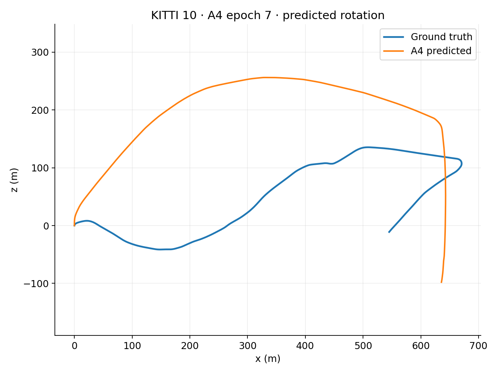
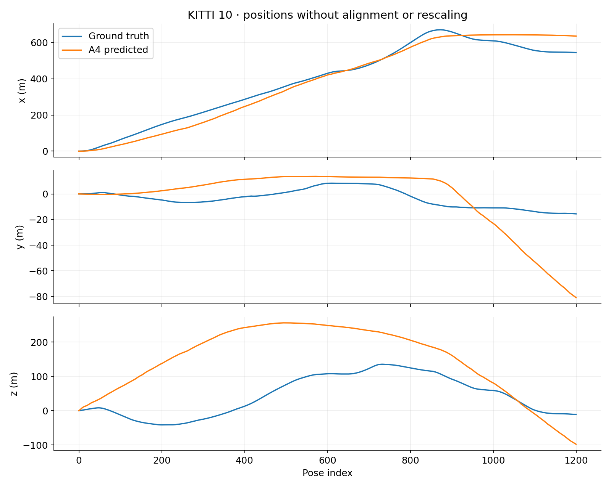

# Deep Visual Odometry — DeepDCT-VO in PyTorch

A PyTorch reimplementation of **DeepDCT-VO: 3D Directional Coordinate Transformation for Low-Complexity Monocular Visual Odometry**, with KITTI experiments and an A4 configuration prepared for Jetson Nano inference.

## Problem

Monocular visual odometry estimates camera motion from successive images. Small relative-pose errors accumulate into trajectory drift, while embedded deployment constrains computation. This project investigates DeepDCT-VO's directional-coordinate representation, the effect of semantic and depth cues, and the gap between frame-level pose accuracy and reconstructed trajectories.

## Implementation and extensions

The supplied source includes DCT label generation and geometry utilities, attention-based residual U-Net components, separate rotation and translation pathways, training and evaluation scripts, and experimental controls. Extensions include alternative frozen semantic/depth providers, translation-head experiments, rotation-source controls, BatchNorm recalibration, trajectory audits, and a Jetson inference script.

DeepDCT-VO is the original authors' method. This repository presents a reimplementation and experimental adaptations; it does not claim the original architecture or auxiliary networks as new work. Confirm the final authorship statement and add the paper's complete citation before publication.

## Featured experiment: LR-ASPP + Lite-Mono

| Setting | Value |
|---|---|
| Dataset | KITTI odometry, left camera |
| Train / validation / test | 00–08 / 09 / 10 |
| Pose input resolution | 120 × 120 |
| Semantic cue | Frozen LR-ASPP, foreground probability |
| Depth cue | Frozen Lite-Mono Tiny; normalized depth, 80 m normalization |
| Translation decoder | Dense |
| Objective | MAE/L1; rotation normalization scale 0.175 |
| Batch size / initial learning rate | 1 / 0.0001 |
| Schedule / selected epoch | 15 epochs / epoch 7, best validation checkpoint |
| Evaluation rotation | Predicted for both Model T conditioning and trajectory reconstruction |
| Trajectory translation scale | 1.0 |

This experiment (A4 in the source and logs) adapts the auxiliary stack to LR-ASPP and Lite-Mono Tiny. It is not an exact reproduction of the paper's auxiliary configuration. The checkpoint was trained with ground-truth rotation conditioning; the featured evaluation switches to predicted rotation. No ground-truth pose is used as a model input in this evaluation. Ground truth is used to calculate metrics.

## Measured results

KITTI sequence 10, 1,200 consecutive frame pairs, A4 epoch 7:

| Metric | Value |
|---|---:|
| Unaligned ATE RMSE | 143.624 m |
| Relative translation error RMSE | 0.334549 m |
| Relative rotation error RMSE | 0.732435° |
| Endpoint error | 141.521 m |
| Endpoint error / ground-truth path length | 15.391% |
| Ground-truth path length | 919.518 m |

ATE is calculated directly between the supplied trajectories, without fitted rigid or similarity alignment. The evaluator reconstructs relative translation from the directional representation before integrating poses. Endpoint percentage is a terminal error diagnostic, not KITTI segment drift.

The supplied evaluation reports 16.80 pairs/s on the GTX reference run. This is evaluation throughput, not a Jetson benchmark. Jetson performance numbers are omitted pending the original benchmark output and hardware settings.





Both plots use the supplied poses directly, with no fitted alignment or rescaling. The trajectory shows substantial accumulated drift; this project is an experimental reproduction rather than a production localization system.

## Experiments

The source snapshot contains A1–A7 experiments covering baseline reproduction, loss normalization, rotation conditioning, auxiliary-network substitutions, translation scaling, translation aggregation, regularization, and BatchNorm controls. See the experiment directories for individual protocols.

The supplied trajectory audit reports 405 metric rows across 17 protocols. Its best sequence-10 deployable row is A4 epoch 7 at 143.624 m ATE. Ground-truth-assisted rows are diagnostic and must not be compared as inference results. These rankings describe the supplied audit coverage, not independently verified results for every saved checkpoint.

## Repository layout

- `deepdct/`: data loading, geometry, models, losses, and training utilities.
- `scripts/`: label generation, training, evaluation, and analysis.
- `configs/`: configuration files.
- `experiments/track_a/paper_reproduction/`: experiment wrappers and documentation.
- `tests/`: geometry, data, model, and training checks.
- `assets/`: plots generated for this README.
- `docs/reproduction_gaps.md`: prerequisites still needed for a complete public release.

## Reproduction

### 1. Obtain the matching source

The supplied source corresponds to revision `b99018f47d82e36ffa08af5a413750426c99a51d`, rather than the older main-branch snapshot described in the project notes.

```bash
git clone https://github.com/sherifdeenlawal/deep-visual-odometry.git
cd deep-visual-odometry
git checkout b99018f47d82e36ffa08af5a413750426c99a51d
export PYTHONPATH="$PWD${PYTHONPATH:+:$PYTHONPATH}"
```

The revision must be available on the remote. These commands were checked against source files, but training and inference were not rerun for this README.

### 2. Prepare dependencies

The source declares Python >=3.10. Historical checkpoint metadata records PyTorch 2.4.1+cu121. A complete validated environment lock is not included.

**Fix the malformed final dependency line before installing:** split `flake8>=7.0timm==1.0.28` into separate `flake8>=7.0` and `timm==1.0.28` lines in `requirements.txt`.

```bash
python3 -m venv .venv
source .venv/bin/activate
python -m pip install --upgrade pip
python -m pip install -r requirements.txt
```

Use a platform-compatible PyTorch build. Jetson Nano needs a separate JetPack-compatible environment; the desktop requirements are not a validated Nano installation recipe.

### 3. Prepare KITTI and auxiliary weights

Obtain KITTI odometry images and poses separately. Expected locations include `data/sequences/00/image_2/`, corresponding sequence folders, and `data/poses/00.txt` through `10.txt`.

```bash
python scripts/generate_kitti_dct_labels.py \
  --input_dir data/poses --output_dir data/out_csv
```

Place the Lite-Mono Tiny weights in `weights/lite-mono-tiny-640x192/`, containing `encoder.pth` and `depth.pth`. Pretrained LR-ASPP weights must also be accessible to torchvision. Weight download links and checksums remain to be supplied.

### 4. Train A4

```bash
bash experiments/track_a/paper_reproduction/a4_lraspp_litemono_auxiliaries/train.sh
```

Review the wrapper and defaults before running. Use the explicit predicted-rotation evaluation below rather than assuming the generic evaluation wrapper reproduces the featured protocol.

### 5. Evaluate with predicted rotation

Obtain the A4 epoch-7 checkpoint and set its path:

```bash
python scripts/evaluate_deepdct_vo.py \
  --checkpoint experiments/track_a/paper_reproduction/a4_lraspp_litemono_auxiliaries/checkpoints/best_validation.pt \
  --data-root data --sequence 10 \
  --output-dir evaluation/a4_sequence10_pred_pred \
  --batch-size 1 --num-workers 0 --device auto \
  --model-t-rotation-source predicted \
  --trajectory-rotation-source predicted \
  --translation-scale-factor 1.0 --euler-order xyz --log-interval 100
```

Checkpoint metadata contains local weight paths. Verify that those paths resolve on your machine before evaluation. The featured checkpoint itself is not included in this documentation package.

### 6. Jetson inference

Copy the supplied `infer_jetson.py` to `scripts/infer_jetson.py`. This script accepts an image directory and does not require ground-truth poses:

```bash
python scripts/infer_jetson.py \
  --checkpoint /path/to/compatible_a4_checkpoint.pt \
  --image-dir /path/to/sequence/image_2 \
  --output-dir outputs/a4_jetson \
  --device cuda --precision fp32 --warmup-pairs 10
```

It records preprocessing, model, and end-to-end timing separately and synchronizes CUDA for timing. The exact checkpoint packaging and Nano software environment remain prerequisites.

## Limitations and release status

- Long-range trajectory drift remains substantial despite smaller frame-level errors.
- Training uses ground-truth rotation conditioning while featured inference uses predicted rotation.
- Checkpoint selection uses sequence 09; sequence 10 is held out for testing, but choosing a featured protocol after comparing test results is retrospective analysis.
- Public checkpoint downloads, weight checksums, a validated environment, and Jetson benchmark logs are still needed.
- Some checkpoint metadata has legacy fields: the effective objective and rotation-source controls take precedence over stale descriptive fields.
- Confirm third-party attribution and license compatibility before distributing auxiliary code or weights. Preserve the repository's existing license; this README does not change it.

## Acknowledgments

DeepDCT-VO's original authors; KITTI; LR-ASPP/torchvision; Lite-Mono; and the auxiliary methods used in supporting experiments. Add complete paper citations and upstream implementation links before publication.
